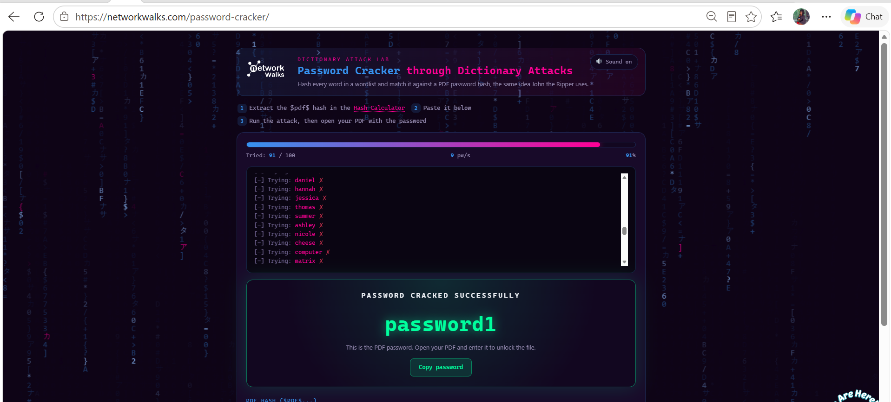
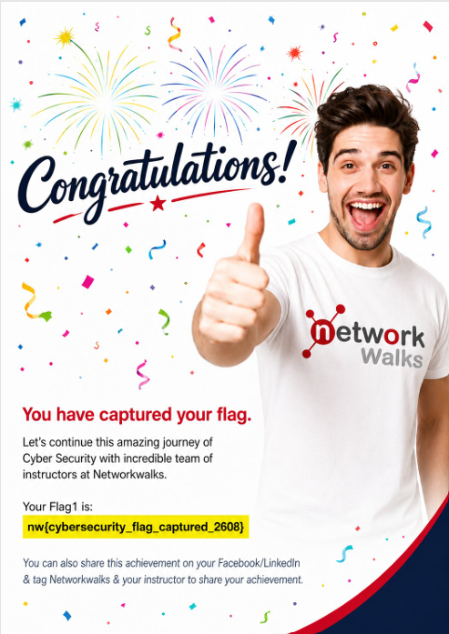

# NETWORKWALKS CYBERSECURITY INTERNSHIP - WEEK 3

**Intern:** Shanice Williams  
**Batch:** B084  
**Project:** Password Cracking with John the Ripper (JTR) & Networkwalks Tools  
**Programme:** Networkwalks Cybersecurity Internship  

---

## PROJECT OVERVIEW

Week 3 focused on password cracking techniques and password security. The practical exercises involved using John the Ripper (JTR) and Networkwalks' online tools to extract password hashes, perform dictionary attacks, and recover passwords from password-protected PDF files.

Both mandatory project modules were completed.

## PROJECT MODULE 1: PASSWORD CRACKING WITH JTR

**Tool Used:** John the Ripper (JTR) and Johnny GUI

### Tasks Completed
- Explored John the Ripper and its graphical interface, Johnny.
- Extracted the password hash from a protected PDF file.
- Saved the extracted hash in a text file.
- Imported the hash file into Johnny.
- Initiated a password-cracking attack.
- Successfully recovered the PDF password.
- Verified the recovered password by opening the protected PDF.

## PROJECT MODULE 2: PASSWORD CRACKING WITH NETWORKWALKS TOOLS

**Tools Used:** Networkwalks Hash Calculator and Password Cracker

### Tasks Completed
- Accessed the Networkwalks Hash Calculator.
- Uploaded the password-protected PDF file.
- Extracted and copied the PDF hash.
- Submitted the hash to the Networkwalks Password Cracker.
- Performed a dictionary attack using the built-in wordlist.
- Monitored the password-cracking progress.
- Successfully recovered the password and unlocked the PDF.

## TOOLS AND TECHNOLOGIES

- John the Ripper (JTR)
- Johnny GUI
- Networkwalks Hash Calculator
- Networkwalks Password Cracker
- Dictionary Attacks
- PDF Hash Extraction
- Windows

## KEY LEARNING OUTCOMES

Through these practical exercises, I gained experience in:

- Understanding password hashing and encryption.
- Extracting password hashes from protected PDF documents.
- Understanding how dictionary attacks work.
- Using password-cracking tools for authorised security testing.
- Identifying the risks associated with weak passwords.
- Understanding the importance of strong and unique passwords.

## EVIDENCE OF COMPLETION

Screenshots documenting the practical exercises and successful flag captures are included as evidence of the completed project modules.

### 1. Networkwalks Password Cracker

### 2. Successful PDF Password Recovery

### 3. First Flag Captured

### 4. Additional Flag Captured – JTR

## CONCLUSION

Week 3 provided valuable hands-on experience in password security testing and ethical hacking. Working with both John the Ripper and Networkwalks' tools strengthened my understanding of password recovery techniques and the importance of effective password security.

Another milestone completed in my cybersecurity learning journey!

---

**Intern:** Shanice Williams  
**Batch:** B084  
**Training Provider:** Networkwalks  
**Week:** 3

#Networkwalks #Cybersecurity #EthicalHacking #PasswordCracking #JohnTheRipper
